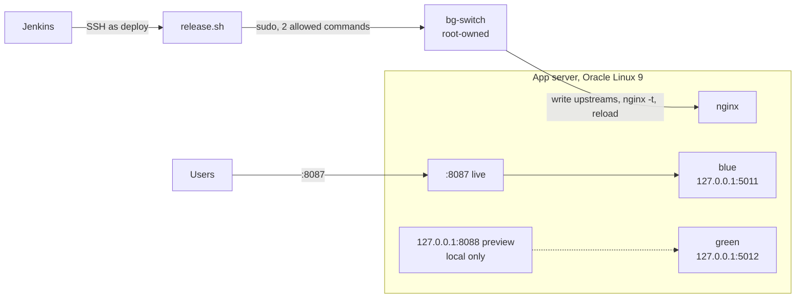

# blue-green-nginx-deploy

Blue-green deployment on Oracle Cloud Infrastructure. Two copies of the app, **blue** and
**green**, run side by side on an Oracle Linux 9 app server as rootless Podman containers.
nginx sends live traffic to one of them. A new release starts in the **idle** slot, is
health-checked and tested there, and only then does nginx move live traffic to it with a
graceful reload. The previous release keeps running, so a rollback is just a second switch,
with no pull and no restart.

Lab 7 of a series of CI/CD labs on OCI (GitHub · Jenkins · Docker · Oracle Linux). The image is
the one [Lab 4](https://github.com/abdulzaferdevops/docker-build-push-ocir) builds, scans and
pushes to OCI Container Registry; the pipeline uses the
[ci-labs shared library](https://github.com/abdulzaferdevops/jenkins-shared-library) (Lab 6).

## Architecture



At any moment one slot is **live** (public port 8087) and the other is **idle** (preview port
8088, bound to 127.0.0.1). Each switch swaps the two roles. nginx adds an `X-Slot` header so
every response says which slot served it.

## Pipeline

| Stage | What it does |
|:--|:--|
| Preflight | Checks settings and SSH; prints both slots |
| Resolve image | Accepts only `…/ci-labs/flask-api@sha256:<64 hex>` from our registry (`labImageRef`) |
| Pull on server | Registry token on stdin into an owner-only temporary auth file, deleted after the pull |
| Stage idle slot | Starts the image in the idle slot and checks `/health` reports the release in the image's label. On failure the slot is stopped and cleared; **live traffic never moves** |
| Preview test | Health and API calls through nginx's preview port, checking `X-Slot` |
| Approve switch | Optional (`APPROVE_SWITCH`): a person confirms before live traffic moves |
| Switch | `bg-switch` moves live traffic, then the public port must serve the new release from the new slot. If not, traffic is switched back automatically |
| Downtime check | A probe calls the public port in a loop for the whole switch; any failed request marks the build **unstable** |

`ACTION=rollback` skips straight to a switch back to the idle slot, after checking it is still
healthy. `ACTION=status` (the default, so a push to this repository changes nothing) shows the slots.

## Least privilege for the switch

`deploy` cannot edit nginx configuration. The only thing it can do as root is run one helper
with one of two words:

```
deploy ALL=(root) NOPASSWD: /usr/local/sbin/bg-switch blue, /usr/local/sbin/bg-switch green
```

`bg-switch` (root:root 0755) writes the two upstreams itself, runs `nginx -t`, restores the
previous file if the test fails, and reloads nginx gracefully, so in-flight requests finish on
the old workers. Any other argument is refused by sudo before the script runs.

## Compared with Lab 5

| | Lab 5 (in place) | Lab 7 (blue-green) |
|:--|:--|:--|
| New release | Replaces the running container | Starts next to it in the idle slot |
| Tested before users see it | Health check after the restart | Health check **and** preview test before any traffic moves |
| Failed release | Automatic rollback after users were affected | Never receives traffic |
| Rollback | Pull and restart the old image | Switch back to the release that is still running |
| Cost | One container | Two containers (2 × 256 MB limit) |

## Server preparation

`setup_bluegreen.sh` (run once as root, after Lab 5's setup): installs `bg-switch` and the sudo
rule, nginx on 8087 (public) and 127.0.0.1:8088 (preview), SELinux port labels, firewalld for
8087 only, and deploy's state folder. A re-run never moves live traffic.

## Results

| Build | Action | Outcome |
|:--|:--|:--|
| [FILL: #] | deploy `00004` | first release into a slot |
| [FILL: #] | deploy `00007` | [FILL: requests / failed during the switch] |
| [FILL: #] | rollback | [FILL: switch seconds, failed requests] |
| [FILL: #] | deploy with `SIMULATE_FAILURE` | [FILL] |

## Licence

MIT
